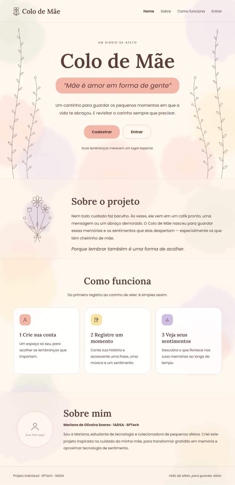

<div align="center">


**Um diário para guardar os momentos em que a gente se sentiu cuidado**

[](#-andamento)
[](#)
[](#)

</div>

<br>

## 💌 Sobre o projeto

Nem todo cuidado faz barulho. Às vezes ele vem em um café pronto, uma mensagem ou um abraço demorado.

O **Colo de Mãe** é um site-diário para guardar essas memórias e os sentimentos que elas despertam, especialmente os que têm cheirinho de mãe. Cada memória tem um **título**, uma **data**, a **descrição** do momento, uma **música**, uma **frase** que marcou, uma **foto**, um **sentimento** e as **pessoas que foram o colo** naquele momento. Cada pessoa começa com quatro sentimentos (Amor, Alegria, Gratidão e Saudade) e quatro colos (Mãe, Amiga, Namorado e Eu mesma), e pode criar e apagar os seus.

Com os registros, o site mostra um **dashboard** com o sentimento mais citado, o colo mais presente, as memórias ao longo do tempo e uma memória sorteada para reler, para a pessoa enxergar o que mais floresce na sua história.

> Porque lembrar também é uma forma de acolher.

<br>

## 🖼️ Como é

<div align="center">



<sub>Protótipo das telas. As outras (cadastro, login, diário, janela da memória e dashboard) estão em <a href="docs/telas-finais">docs/telas-finais</a>.</sub>

</div>

<br>

## ✨ O que o site faz

- 🌱 **Cadastro e login** — cada pessoa tem o seu cantinho, com validação dos campos.
- 📖 **Diário** — registrar, reler, editar e apagar memórias, cada uma com música, frase, foto, sentimento e quem foi o colo.
- 🌷 **Sentimentos e pessoas só seus** — cada usuário começa com os iniciais e pode criar e apagar os próprios.
- 🖼️ **Foto da memória** — por link, e abre em tamanho grande pelo botão **Ver foto**.
- 📊 **Dashboard** — sentimento mais citado, colo mais presente, total de memórias, memórias por mês, memória sorteada e o que cada colo desperta.
- 🎨 **Sentimentos em cores** — cada sentimento tem a sua cor nos cards e nos gráficos.

> [!NOTE]
> O projeto está **em desenvolvimento**. O que já está pronto e o que falta está na seção [Andamento](#-andamento).

<br>

## 🧩 Como as camadas conversam

```
 Navegador (HTML + CSS + JavaScript)
        │   requisições HTTP (fetch)
        ▼
 API Node.js  ───────►  Banco de dados MySQL
                         rodando em uma VM Linux
```

| Camada | O que faz |
|---|---|
| **Frontend** | Páginas, estilo, validação dos formulários e gráficos (Chart.js) |
| **Backend** | API em Node.js com Express: recebe os dados do site, grava e consulta no banco |
| **Banco de dados** | MySQL com 5 tabelas: `usuario`, `sentimento`, `colo`, `memoria` e `memoria_colo` |

**Relacionamentos:** um usuário tem várias memórias, vários sentimentos e vários colos (1:n); um sentimento está em várias memórias (1:n); uma memória tem vários colos e um colo está em várias memórias (n:n, pela tabela `memoria_colo`).

<br>

## 🔗 Links do projeto

| | |
|---|---|
| 📄 Documentação do projeto | [documento-projeto.docx](docs/documento-projeto.docx) |
| 🗃️ Modelo lógico do banco | [modelo-logico.png](docs/modelo-logico.png) |
| 🧮 Scripts SQL | [banco/](banco/) |
| 🤖 Diário de prompts (uso de IA) | [diario-de-prompts.md](docs/diario-de-prompts.md) |
| 🗂️ Organização do projeto | [Trello](https://trello.com/b/nF6ukCsZ/colo-de-mae) |

<br>

## 🧪 Tecnologias


<br>

## 🗺️ Andamento

- [x] Tema e documento do projeto
- [x] Repositório no Git, backlog e quadro no Trello
- [x] Modelo lógico e script do banco
- [x] Consultas dos indicadores
- [x] Esboço das telas e identidade visual
- [x] Página Home
- [x] Telas de cadastro e login com validação em JavaScript
- [x] API em Node.js conectada ao banco
- [x] Diário e dashboard funcionando
- [x] Banco na VM Linux
- [ ] Documentação final
- [ ] Apresentação final

<br>

## ▶️ Como rodar

1. Ligue a VM Linux com o MySQL (o VirtualBox encaminha a porta `3307` do seu computador para a `3306` da VM) e conecte o MySQL Workbench em `127.0.0.1:3307`.
2. Nessa conexão, rode o [script.sql](banco/script.sql). Ele **apaga e recria** o banco `colo_de_mae`, já com a conta de teste.
3. Na pasta `api/`, copie o `.env.example` para `.env.dev` e preencha o usuário e a senha do MySQL da VM.
4. Ainda em `api/`, rode `npm install` e depois `node app.js`.
5. Abra `http://localhost:3333` no navegador.

Para testar, use a conta que o script cria: `mariana@exemplo.com` / `123`. Todos os dados são fictícios, feitos por fins educacionais.

<br>

## 🤖 Uso de IA

A IA foi usada só como apoio: tirar dúvidas, revisar e sugerir trechos. Tudo o que foi pedido, usado e modificado está registrado no [Diário de Prompts](docs/diario-de-prompts.md).

<br>

## 👩‍💻 Autora

**Mariana de Oliveira Soares** · 1ADSA · SPTech

<br>

<div align="center">

</div>